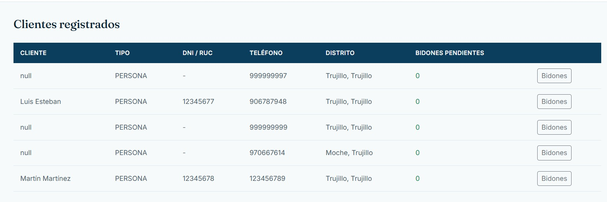
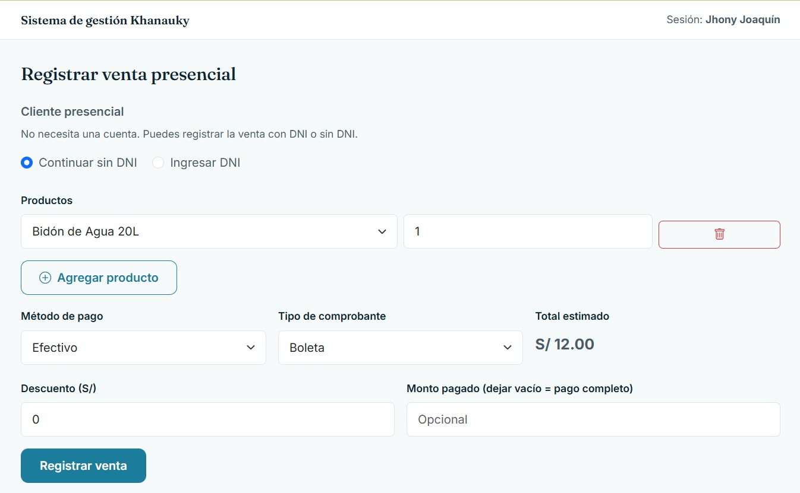
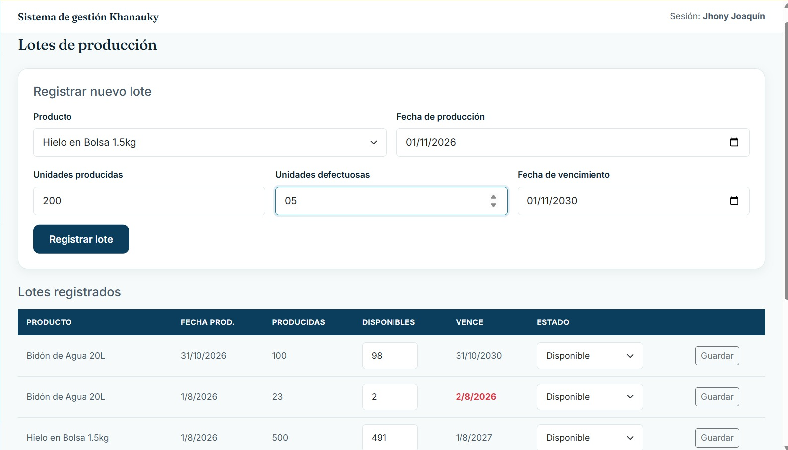
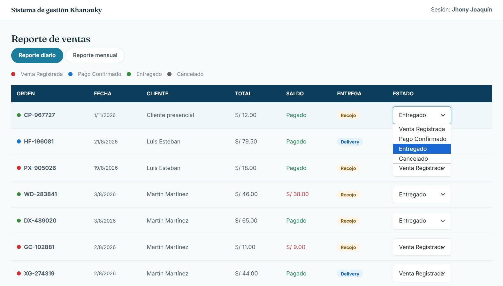
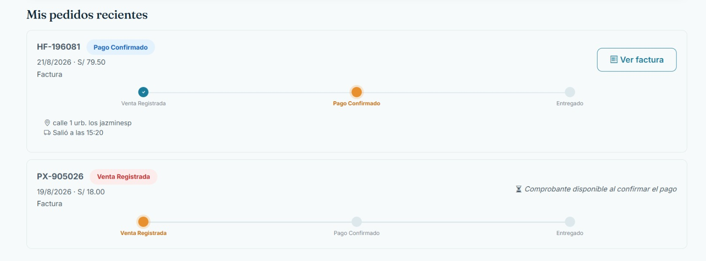

# Prototipo y flujo de navegación - Khanauky

## 1. Propósito

En esta sección se presentan interfaces reales del sistema Khanauky relacionadas con los casos de uso definidos en el Laboratorio 3.

Las evidencias permiten comprobar que los casos de uso modelados tienen una representación dentro del sistema implementado.

Cada pantalla utiliza un identificador de trazabilidad asociado al caso de uso correspondiente.

---

## 2. Interfaces del sistema

### UI-CU001-01 - Clientes registrados

Esta pantalla permite consultar los clientes registrados en el sistema Khanauky.

Se visualiza información como:

- Nombre del cliente.
- Tipo de cliente.
- DNI o RUC.
- Teléfono.
- Distrito.
- Bidones pendientes.

Esta interfaz permite comprobar que el sistema dispone de información relacionada con la gestión y consulta de clientes.

**Caso de uso relacionado:** CU-001 Gestionar clientes.

---

### UI-CU003-01 - Registrar venta o pedido

Esta interfaz permite registrar una venta presencial en el sistema Khanauky.

Durante el registro se puede:

- Identificar al cliente mediante DNI o continuar sin DNI.
- Seleccionar uno o más productos.
- Registrar las cantidades solicitadas.
- Seleccionar el método de pago.
- Seleccionar el tipo de comprobante.
- Registrar un descuento.
- Visualizar el total estimado.
- Registrar el monto pagado.
- Confirmar la venta.

Esta pantalla representa una implementación del proceso utilizado para registrar una solicitud de productos dentro del sistema.

**Caso de uso relacionado:** CU-003 Registrar pedido.

---

### UI-CU005-01 - Registro y consulta de producción

Esta interfaz permite registrar nuevos lotes de producción y consultar los lotes existentes.

Para registrar un lote se puede especificar:

- Producto.
- Fecha de producción.
- Unidades producidas.
- Unidades defectuosas.
- Fecha de vencimiento.

También se muestran los lotes registrados, indicando las unidades producidas, unidades disponibles, fecha de vencimiento y estado.

Esta pantalla permite relacionar la producción registrada con la disponibilidad posterior de productos.

**Caso de uso relacionado:** CU-005 Registrar producción.

---

### UI-CU007-01 - Reporte y estado de ventas

Esta interfaz permite consultar las ventas registradas y visualizar el estado actual de cada operación.

La pantalla muestra información como:

- Número de orden.
- Fecha.
- Cliente.
- Total.
- Saldo.
- Tipo de entrega.
- Estado.

Los estados disponibles incluyen:

- Venta Registrada.
- Pago Confirmado.
- Entregado.
- Cancelado.

Esta funcionalidad permite conocer y actualizar el avance de una venta o pedido.

**Caso de uso relacionado:** CU-007 Consultar estado del pedido.

---

### UI-CU007-02 - Seguimiento de pedidos

Esta interfaz permite visualizar el avance de los pedidos recientes mediante una representación gráfica de sus estados.

El flujo mostrado puede incluir:

**Venta Registrada → Pago Confirmado → Entregado**

Además, se puede consultar información asociada al pedido, como:

- Número de pedido.
- Fecha.
- Importe.
- Tipo de comprobante.
- Dirección de entrega.
- Estado actual.

Esta pantalla facilita el seguimiento del pedido y permite identificar rápidamente en qué etapa se encuentra.

**Caso de uso relacionado:** CU-007 Consultar estado del pedido.

---

## 3. Flujo de navegación

A partir de las interfaces implementadas en Khanauky, un flujo general del sistema puede representarse de la siguiente manera:

**Consultar cliente → Registrar pedido o venta → Verificar disponibilidad y producción → Consultar estado → Entregar pedido**

El proceso puede comenzar con la identificación o consulta del cliente.

Posteriormente se registran los productos y cantidades solicitadas.

Cuando corresponde, la disponibilidad de productos puede relacionarse con los lotes de producción registrados.

Finalmente, el vendedor o responsable puede consultar el estado de la operación hasta llegar a la entrega del pedido.

---

## 4. Matriz de trazabilidad entre interfaz y caso de uso

| ID de interfaz | Pantalla | Caso de uso relacionado |
|---|---|---|
| UI-CU001-01 | Clientes registrados | CU-001 Gestionar clientes |
| UI-CU003-01 | Registrar venta o pedido | CU-003 Registrar pedido |
| UI-CU005-01 | Lotes de producción | CU-005 Registrar producción |
| UI-CU007-01 | Reporte y estado de ventas | CU-007 Consultar estado del pedido |
| UI-CU007-02 | Seguimiento de pedidos | CU-007 Consultar estado del pedido |

---

## 5. Relación con el modelado

Las interfaces presentadas permiten comprobar la relación entre la documentación elaborada y la implementación real del proyecto Khanauky.

Los identificadores utilizados permiten mantener una relación directa entre:

**Interfaz → Caso de uso → Funcionalidad del sistema**

De esta manera, las pantallas no se presentan únicamente como evidencia visual, sino como parte de la trazabilidad del proyecto.

---

## 6. Resultado

Las evidencias muestran que varios de los casos de uso definidos en el Laboratorio 3 tienen una representación funcional dentro del sistema Khanauky.

La identificación de cada interfaz mediante códigos UI-CU facilita la revisión de consistencia entre el modelado de casos de uso y las funcionalidades implementadas.
